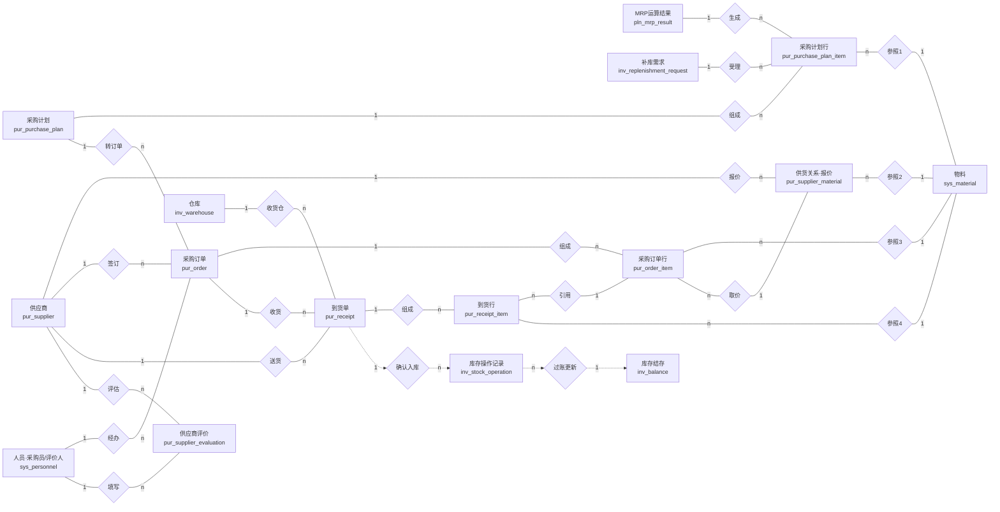

# 采购模块系统信息概念模型（System Information Conceptual Model）

> 本文是采购模块的信息概念模型与物理数据模型说明文档。概念模型（E-R 图）采用
> **Chen 记号**（矩形 = 实体、菱形 = 联系、连线标注 1/n 基数），图中**全部实体与联系
> 均来源于本地项目实际代码**（`backend/app/modules/procurement/models.py` 及其引用的
> system / inventory / planning 模块表），不引入项目外的虚构实体。
>
> - 概念模型：第 2~4 节（实体清单、E-R 图、联系说明）
> - 物理模型：第 5 节（图 2 系统数据结构物理模型，逐表逐字段）
> - 关联文档：[functional-design.md](functional-design.md)、[data-flow-diagrams.md](data-flow-diagrams.md)、
>   [module-relationships.md](module-relationships.md)、全库模型见
>   [../database/full-er-diagram.md](../database/full-er-diagram.md) 与
>   [../database/physical-data-model.md](../database/physical-data-model.md)

## 一、建模依据与行业规范约定

本模型遵循以下行业规范（与项目《开发规格》§18~§24 一致）：

1. **主数据 / 单据分离**：供应商、物料、仓库、人员为主数据实体；采购计划、采购订单、
   到货单为业务单据实体，均采用**头 - 行（Header-Line）**两层结构。
2. **主键规范**：所有业务表统一 `id BIGINT` 自增主键；单据编号（`plan_no` / `order_no` /
   `receipt_no` / `supplier_code`）为 `VARCHAR(50)` 唯一业务键。
3. **数量与金额精度**：数量 `DECIMAL(18,4)`、金额 `DECIMAL(18,2)`、评分 `DECIMAL(8,4)`，
   禁止用 FLOAT 存储关键数量与金额。
4. **引用完整性**：模块内单据行 → 头表用 `CASCADE`；单据 → 主数据用 `RESTRICT`
   （防止删除仍被单据引用的主数据）。
5. **模块边界（数据所有权）**：跨模块单据关联**只用 ID 引用，不建跨库外键**；
   库存数量只由 inventory 模块维护，采购到货确认经 `inventory.contract.increase_stock`
   契约写入，不直接改库存表。
6. **审计追踪**：所有表携带 `created_at / updated_at / created_by / updated_by` 审计列。

## 二、实体清单（概念实体 ↔ 本地数据表）

| 概念实体 | 本地表 | 所属模块 | 角色 |
| --- | --- | --- | --- |
| 供应商 | `pur_supplier` | procurement | 主数据 |
| 供货关系（报价） | `pur_supplier_material` | procurement | 主数据（N:M 关联，含供货价） |
| 采购计划 | `pur_purchase_plan` | procurement | 业务单据头 |
| 采购计划行 | `pur_purchase_plan_item` | procurement | 业务单据行 |
| 采购订单 | `pur_order` | procurement | 业务单据头 |
| 采购订单行 | `pur_order_item` | procurement | 业务单据行 |
| 到货单（收货单） | `pur_receipt` | procurement | 业务单据头 |
| 到货行 | `pur_receipt_item` | procurement | 业务单据行 |
| 供应商评价 | `pur_supplier_evaluation` | procurement | 业务记录 |
| 物料 | `sys_material` | system（只读引用） | 主数据 |
| 人员（采购员/评价人） | `sys_personnel` | system（只读引用） | 主数据 |
| 仓库 | `inv_warehouse` | inventory（只读引用） | 主数据 |
| MRP 运算结果 | `pln_mrp_result` | planning（来源单据） | 需求来源 |
| 补库需求 | `inv_replenishment_request` | inventory（来源单据） | 需求来源 |
| 库存操作记录 | `inv_stock_operation` | inventory（经契约写入） | 流水 |
| 库存结存 | `inv_balance` | inventory（经契约更新） | 主数据（库存所有方） |

## 三、实体关系图（E-R 图）

**图 1　采购模块系统信息概念模型（E-R 图，Chen 记号）**

矩形为实体（标注本地表名），菱形为联系，连线标注 1 / n 基数；虚线菱形为跨模块契约联系（无物理外键）。

## 四、联系说明

| 联系 | 参与实体（基数） | 承载方式（本地项目实现） |
| --- | --- | --- |
| 生成 | MRP运算结果 1 — n 计划行 | `pur_purchase_plan_item.source_type='MRP'` + `source_reference_id` 多态引用，经 `planning.contract.get_mrp_results` 读取，**无物理外键** |
| 受理 | 补库需求 1 — n 计划行 | `source_type='REORDER'` + `source_reference_id`，经 `inventory.contract.get_replenishment_request` 读取，**无物理外键** |
| 组成（计划） | 采购计划 1 — n 计划行 | `plan_id` 物理外键 `CASCADE` |
| 参照1 / 参照3 / 参照4 | 计划行/订单行/到货行 n — 1 物料 | `material_id` 物理外键 `RESTRICT`（跨模块 JOIN 禁止，仅 DB 层引用完整性） |
| 报价 | 供应商 1 — n 供货关系 | `supplier_id` 物理外键 `CASCADE`；`(supplier_id, material_id)` 唯一 |
| 参照2 | 供货关系 n — 1 物料 | `material_id` 物理外键 `RESTRICT` |
| 转订单 | 采购计划 1 — n 采购订单 | 计划下达（RELEASED）后按"未下单数量 > 0"的行生成订单，回写计划行 `ordered_qty`；无物理外键（业务回写） |
| 组成（订单） | 采购订单 1 — n 订单行 | `order_id` 物理外键 `CASCADE`；`(order_id, line_no)` 唯一 |
| 取价 | 订单行 n — 1 供货关系 | 由计划生成订单时取 `supply_price` 作为 `unit_price`（业务逻辑，无外键） |
| 签订 | 供应商 1 — n 采购订单 | `pur_order.supplier_id` 物理外键 `RESTRICT` |
| 经办 | 人员 1 — n 采购订单 | `buyer_id` 物理外键 `RESTRICT`，可空 |
| 收货 | 采购订单 1 — n 到货单 | `pur_receipt.purchase_order_id` 物理外键 `RESTRICT` |
| 送货 | 供应商 1 — n 到货单 | `pur_receipt.supplier_id` 物理外键 `RESTRICT` |
| 收货仓 | 仓库 1 — n 到货单 | `warehouse_id` 物理外键 `RESTRICT` |
| 组成（到货） | 到货单 1 — n 到货行 | `receipt_id` 物理外键 `CASCADE` |
| 引用 | 到货行 n — 1 订单行 | `order_item_id` 物理外键 `RESTRICT`（超交校验 4004 依据） |
| 确认入库 | 到货单 1 — n 库存操作记录 | 到货确认逐行调 `inventory.contract.increase_stock` 写入库流水，**跨模块契约，无物理外键**；契约未就绪返回 4007 整单回滚 |
| 过账更新 | 库存操作记录 n — 1 库存结存 | inventory 引擎在同一事务内更新 `inv_balance`；库存数量所有方为 inventory 模块 |
| 评估 | 供应商 1 — n 供应商评价 | `supplier_id` 物理外键 `CASCADE` |
| 填写 | 人员 1 — n 供应商评价 | `evaluator_id` 物理外键 `RESTRICT`，可空 |

**与参考模型（教材通用采购 E-R 图）的映射与差异说明**：

| 参考图实体/联系 | 本地项目对应 | 差异说明 |
| --- | --- | --- |
| 物料需求计划 | `pln_mrp_result`（planning）+ `inv_replenishment_request`（inventory） | 需求来源拆分为 MRP BUY 结果与订货点补库需求两条链路 |
| 请购单 → 合并 → 采购订单 | 采购计划 → 转订单 → 采购订单 | 本地以"采购计划"承载请购汇总语义，按计划行未下单数量生成订单 |
| 报价 | `pur_supplier_material.supply_price` | 报价落为供应商-物料供货关系的供货价字段 |
| 检验单 | 到货行 `qualified_qty`（合格数量） | 课程范围**不设质量模块**，来料检验简化为到货行合格数量字段，入库按合格数量执行 |
| 物料库存 | `inv_balance`（库存结存） | 库存所有方为 inventory 模块，采购不直接读写 |
| 库存操作记录 | `inv_stock_operation` | 由 inventory 契约写入，来源类型 `PURCHASE_RECEIPT` |
| 过账凭证 | 无独立实体 | 入库过账由 inventory 引擎在同一事务内写流水并更新结存，过账凭证即 `inv_stock_operation` 流水记录 |

## 五、系统数据结构物理模型

**图 2　系统数据结构物理模型（采购模块）**

> 类型为 MySQL 实际类型；"是否为关键字"标注主键 / 唯一键 / 外键；"可否为空"为"是"表示允许 NULL。
> 所有表均携带统一审计列（`AuditMixin`）。引用他模块表仅在数据库层保持引用完整性，
> 业务层不跨模块 JOIN（见第 4 条行业规范）。

### 表 1　供应商信息表 `pur_supplier`

| 名称 | 变量名 | 类型 | 是否为关键字 | 可否为空 | 关联表及关联字段 |
| --- | --- | --- | --- | --- | --- |
| 供应商ID | id | BIGINT | 是（主键） | 否 | — |
| 供应商编码 | supplier_code | VARCHAR(50) | 是（唯一） | 否 | — |
| 供应商名称 | supplier_name | VARCHAR(100) |  | 否 | — |
| 联系人 | contact_person | VARCHAR(50) |  | 是 | — |
| 联系电话 | phone | VARCHAR(30) |  | 是 | — |
| 电子邮箱 | email | VARCHAR(100) |  | 是 | — |
| 地址 | address | VARCHAR(200) |  | 是 | — |
| 状态 | status | VARCHAR(20) |  | 否 | 取值 ACTIVE / INACTIVE（CHECK 约束） |
| 备注 | remark | TEXT |  | 是 | — |
| 创建时间 | created_at | DATETIME |  | 否 | — |
| 更新时间 | updated_at | DATETIME |  | 否 | — |
| 创建人 | created_by | BIGINT |  | 是 | 引自 sys_user 表 id 字段（逻辑引用，无物理外键） |
| 更新人 | updated_by | BIGINT |  | 是 | 引自 sys_user 表 id 字段（逻辑引用，无物理外键） |

### 表 2　供应商物料关系表（供货关系/报价表）`pur_supplier_material`

| 名称 | 变量名 | 类型 | 是否为关键字 | 可否为空 | 关联表及关联字段 |
| --- | --- | --- | --- | --- | --- |
| 关系ID | id | BIGINT | 是（主键） | 否 | — |
| 供应商ID | supplier_id | BIGINT | 是（外键，联合唯一） | 否 | 引自 pur_supplier 表 id 字段（ON DELETE CASCADE） |
| 物料ID | material_id | BIGINT | 是（外键，联合唯一） | 否 | 引自 sys_material 表 id 字段（ON DELETE RESTRICT） |
| 是否主供应商 | is_primary | TINYINT(1) |  | 否 | — |
| 供货单价 | supply_price | DECIMAL(18,2) |  | 否 | — |
| 供货提前期（天） | lead_time_days | INT |  | 否 | 界面已下线，DB 保留兼容字段 |
| 最小起订量 | min_order_qty | DECIMAL(18,4) |  | 否 | — |
| 状态 | status | VARCHAR(20) |  | 否 | — |
| 创建时间 | created_at | DATETIME |  | 否 | — |
| 更新时间 | updated_at | DATETIME |  | 否 | — |
| 创建人 | created_by | BIGINT |  | 是 | 引自 sys_user 表 id 字段（逻辑引用） |
| 更新人 | updated_by | BIGINT |  | 是 | 引自 sys_user 表 id 字段（逻辑引用） |

> 唯一约束 `(supplier_id, material_id)`；`supply_price >= 0`、`lead_time_days >= 0` CHECK 约束。

### 表 3　采购计划表（头表）`pur_purchase_plan`

| 名称 | 变量名 | 类型 | 是否为关键字 | 可否为空 | 关联表及关联字段 |
| --- | --- | --- | --- | --- | --- |
| 计划ID | id | BIGINT | 是（主键） | 否 | — |
| 计划编号 | plan_no | VARCHAR(50) | 是（唯一） | 否 | — |
| 计划日期 | plan_date | DATE |  | 否 | — |
| 状态 | status | VARCHAR(20) |  | 否 | 取值 DRAFT / CONFIRMED / RELEASED / COMPLETED / CANCELLED |
| 备注 | remark | TEXT |  | 是 | — |
| 创建时间 | created_at | DATETIME |  | 否 | — |
| 更新时间 | updated_at | DATETIME |  | 否 | — |
| 创建人 | created_by | BIGINT |  | 是 | 引自 sys_user 表 id 字段（逻辑引用） |
| 更新人 | updated_by | BIGINT |  | 是 | 引自 sys_user 表 id 字段（逻辑引用） |

### 表 4　采购计划行表（明细表）`pur_purchase_plan_item`

| 名称 | 变量名 | 类型 | 是否为关键字 | 可否为空 | 关联表及关联字段 |
| --- | --- | --- | --- | --- | --- |
| 计划行ID | id | BIGINT | 是（主键） | 否 | — |
| 计划头ID | plan_id | BIGINT | 是（外键） | 否 | 引自 pur_purchase_plan 表 id 字段（ON DELETE CASCADE） |
| 物料ID | material_id | BIGINT | 是（外键） | 否 | 引自 sys_material 表 id 字段（ON DELETE RESTRICT） |
| 需求数量 | required_qty | DECIMAL(18,4) |  | 否 | — |
| 已下单数量 | ordered_qty | DECIMAL(18,4) |  | 否 | 由转订单流程回写 |
| 需求日期 | required_date | DATE |  | 否 | — |
| 来源类型 | source_type | VARCHAR(30) |  | 否 | 取值 MRP / REORDER / MANUAL |
| 来源单据ID | source_reference_id | BIGINT | 是（多态引用） | 是 | 按 source_type 引自 pln_mrp_result 表 id 或 inv_replenishment_request 表 id（**无物理外键**，仅索引） |
| 建议供应商ID | supplier_id | BIGINT | 是（外键） | 是 | 引自 pur_supplier 表 id 字段（ON DELETE RESTRICT） |
| 状态 | status | VARCHAR(20) |  | 否 | 同计划头状态机 |
| 备注 | remark | VARCHAR(200) |  | 是 | — |
| 创建时间 | created_at | DATETIME |  | 否 | — |
| 更新时间 | updated_at | DATETIME |  | 否 | — |
| 创建人 | created_by | BIGINT |  | 是 | 引自 sys_user 表 id 字段（逻辑引用） |
| 更新人 | updated_by | BIGINT |  | 是 | 引自 sys_user 表 id 字段（逻辑引用） |

### 表 5　采购订单表（头表）`pur_order`

| 名称 | 变量名 | 类型 | 是否为关键字 | 可否为空 | 关联表及关联字段 |
| --- | --- | --- | --- | --- | --- |
| 订单ID | id | BIGINT | 是（主键） | 否 | — |
| 订单号 | order_no | VARCHAR(50) | 是（唯一） | 否 | — |
| 供应商ID | supplier_id | BIGINT | 是（外键） | 否 | 引自 pur_supplier 表 id 字段（ON DELETE RESTRICT） |
| 下单日期 | order_date | DATE |  | 否 | — |
| 预计到货日期 | expected_date | DATE |  | 否 | 未显式传入时 = 下单日 + 物料最大提前期 |
| 采购员ID | buyer_id | BIGINT | 是（外键） | 是 | 引自 sys_personnel 表 id 字段（ON DELETE RESTRICT） |
| 订单总金额 | total_amount | DECIMAL(18,2) |  | 否 | — |
| 状态 | status | VARCHAR(20) |  | 否 | 取值 DRAFT / CONFIRMED / RELEASED / IN_PROGRESS / COMPLETED / CANCELLED |
| 备注 | remark | TEXT |  | 是 | — |
| 创建时间 | created_at | DATETIME |  | 否 | — |
| 更新时间 | updated_at | DATETIME |  | 否 | — |
| 创建人 | created_by | BIGINT |  | 是 | 引自 sys_user 表 id 字段（逻辑引用） |
| 更新人 | updated_by | BIGINT |  | 是 | 引自 sys_user 表 id 字段（逻辑引用） |

### 表 6　采购订单行表（明细表）`pur_order_item`

| 名称 | 变量名 | 类型 | 是否为关键字 | 可否为空 | 关联表及关联字段 |
| --- | --- | --- | --- | --- | --- |
| 订单行ID | id | BIGINT | 是（主键） | 否 | — |
| 订单头ID | order_id | BIGINT | 是（外键，联合唯一） | 否 | 引自 pur_order 表 id 字段（ON DELETE CASCADE） |
| 行号 | line_no | INT | 是（联合唯一） | 否 | 与 order_id 组成唯一约束 |
| 物料ID | material_id | BIGINT | 是（外键） | 否 | 引自 sys_material 表 id 字段（ON DELETE RESTRICT） |
| 采购数量 | quantity | DECIMAL(18,4) |  | 否 | — |
| 已到货数量 | received_qty | DECIMAL(18,4) |  | 否 | 由到货确认流程回写 |
| 单价 | unit_price | DECIMAL(18,2) |  | 否 | 由计划生成时取供货关系 supply_price |
| 金额 | amount | DECIMAL(18,2) |  | 否 | = quantity × unit_price |
| 备注 | remark | VARCHAR(200) |  | 是 | — |
| 创建时间 | created_at | DATETIME |  | 否 | — |
| 更新时间 | updated_at | DATETIME |  | 否 | — |
| 创建人 | created_by | BIGINT |  | 是 | 引自 sys_user 表 id 字段（逻辑引用） |
| 更新人 | updated_by | BIGINT |  | 是 | 引自 sys_user 表 id 字段（逻辑引用） |

### 表 7　到货单表（收货单头表）`pur_receipt`

| 名称 | 变量名 | 类型 | 是否为关键字 | 可否为空 | 关联表及关联字段 |
| --- | --- | --- | --- | --- | --- |
| 到货单ID | id | BIGINT | 是（主键） | 否 | — |
| 到货单号 | receipt_no | VARCHAR(50) | 是（唯一） | 否 | — |
| 采购订单ID | purchase_order_id | BIGINT | 是（外键） | 否 | 引自 pur_order 表 id 字段（ON DELETE RESTRICT） |
| 供应商ID | supplier_id | BIGINT | 是（外键） | 否 | 引自 pur_supplier 表 id 字段（ON DELETE RESTRICT） |
| 收货仓库ID | warehouse_id | BIGINT | 是（外键） | 否 | 引自 inv_warehouse 表 id 字段（ON DELETE RESTRICT） |
| 到货日期 | receipt_date | DATE |  | 否 | — |
| 状态 | status | VARCHAR(20) |  | 否 | 取值 DRAFT / CONFIRMED / COMPLETED / CANCELLED |
| 备注 | remark | TEXT |  | 是 | — |
| 创建时间 | created_at | DATETIME |  | 否 | — |
| 更新时间 | updated_at | DATETIME |  | 否 | — |
| 创建人 | created_by | BIGINT |  | 是 | 引自 sys_user 表 id 字段（逻辑引用） |
| 更新人 | updated_by | BIGINT |  | 是 | 引自 sys_user 表 id 字段（逻辑引用） |

### 表 8　到货单行表（明细表）`pur_receipt_item`

| 名称 | 变量名 | 类型 | 是否为关键字 | 可否为空 | 关联表及关联字段 |
| --- | --- | --- | --- | --- | --- |
| 到货行ID | id | BIGINT | 是（主键） | 否 | — |
| 到货单头ID | receipt_id | BIGINT | 是（外键） | 否 | 引自 pur_receipt 表 id 字段（ON DELETE CASCADE） |
| 订单行ID | order_item_id | BIGINT | 是（外键） | 否 | 引自 pur_order_item 表 id 字段（ON DELETE RESTRICT） |
| 物料ID | material_id | BIGINT | 是（外键） | 否 | 引自 sys_material 表 id 字段（ON DELETE RESTRICT） |
| 到货数量 | quantity | DECIMAL(18,4) |  | 否 | — |
| 合格数量 | qualified_qty | DECIMAL(18,4) |  | 否 | 来料检验简化字段，确认后按此数量入库 |
| 备注 | remark | VARCHAR(200) |  | 是 | — |
| 创建时间 | created_at | DATETIME |  | 否 | — |
| 更新时间 | updated_at | DATETIME |  | 否 | — |
| 创建人 | created_by | BIGINT |  | 是 | 引自 sys_user 表 id 字段（逻辑引用） |
| 更新人 | updated_by | BIGINT |  | 是 | 引自 sys_user 表 id 字段（逻辑引用） |

### 表 9　供应商评价表（供应商评估表）`pur_supplier_evaluation`

| 名称 | 变量名 | 类型 | 是否为关键字 | 可否为空 | 关联表及关联字段 |
| --- | --- | --- | --- | --- | --- |
| 评价ID | id | BIGINT | 是（主键） | 否 | — |
| 供应商ID | supplier_id | BIGINT | 是（外键） | 否 | 引自 pur_supplier 表 id 字段（ON DELETE CASCADE） |
| 评价日期 | evaluate_date | DATE |  | 否 | — |
| 质量评分 | quality_score | DECIMAL(8,4) |  | 否 | 取值 0~100（CHECK 约束） |
| 交期评分 | delivery_score | DECIMAL(8,4) |  | 否 | 取值 0~100（CHECK 约束） |
| 价格评分 | price_score | DECIMAL(8,4) |  | 否 | 取值 0~100（CHECK 约束） |
| 综合评分 | total_score | DECIMAL(8,4) |  | 否 | = 三项评分简单平均（ROUND 4 位小数） |
| 评价人ID | evaluator_id | BIGINT | 是（外键） | 是 | 引自 sys_personnel 表 id 字段（ON DELETE RESTRICT） |
| 备注 | remark | TEXT |  | 是 | — |
| 创建时间 | created_at | DATETIME |  | 否 | — |
| 更新时间 | updated_at | DATETIME |  | 否 | — |
| 创建人 | created_by | BIGINT |  | 是 | 引自 sys_user 表 id 字段（逻辑引用） |
| 更新人 | updated_by | BIGINT |  | 是 | 引自 sys_user 表 id 字段（逻辑引用） |

### 被引用的他模块表（只读 / 契约写入，所有权归对方模块）

| 表名 | 所属模块 | 本模块引用方式 |
| --- | --- | --- |
| `sys_material` 物料主数据 | system | `material_id` 物理外键（RESTRICT）；业务层经 `system.contract.get_material(s)` 只读 |
| `sys_personnel` 人员 | system | `buyer_id` / `evaluator_id` 物理外键（RESTRICT）；经 `system.contract.get_personnel_name` 只读 |
| `inv_warehouse` 仓库 | inventory | `warehouse_id` 物理外键（RESTRICT） |
| `pln_mrp_result` MRP 结果行 | planning | 计划行 `source_reference_id` 多态引用（无物理外键）；经 `planning.contract.get_mrp_results` 读取 |
| `inv_replenishment_request` 补库需求 | inventory | 计划行 `source_reference_id` 多态引用（无物理外键）；经 `inventory.contract.get_replenishment_request` 读取 |
| `inv_stock_operation` 库存操作记录 | inventory | 到货确认经 `inventory.contract.increase_stock` 写入，无物理外键 |
| `inv_balance` 库存结存 | inventory | 由 inventory 引擎随流水更新，采购模块不直接读写 |
